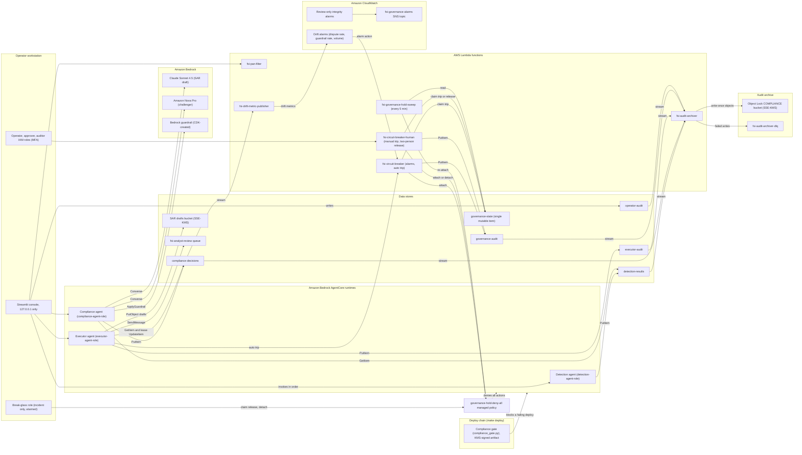

# Architecture

This page describes what `make deploy` creates and how the pieces talk to each
other. The source of truth is the CDK app: [cdk/data_stack.py](../cdk/data_stack.py),
[cdk/agents_stack.py](../cdk/agents_stack.py), [cdk/audit_archive.py](../cdk/audit_archive.py)
and [cdk/deploy_agentcore_runtimes.py](../cdk/deploy_agentcore_runtimes.py).
If this page and the code disagree, the code wins.

The sample runs on synthetic data only. Nothing is filed with FinCEN or any
regulator: the executor writes SAR drafts to an S3 bucket and review items to
an SQS queue for a human analyst.

## Diagram

## Data flow

1. The operator signs in to the console on `127.0.0.1`. Each action uses the
   operator's own MFA-backed role profile; there is no shared credential.
2. The console invokes the detection runtime with a `dataset_id`. Detection
   loads the bundled synthetic dataset, runs the PAN filter in-process, builds
   the transaction graph (cuGraph on GPU, NetworkX on CPU), and writes the
   result to `detection-results`.
3. The console invokes the compliance runtime with that detection. Compliance
   reads the recorded detection by id, asks Claude Sonnet 4.5 for a SAR draft
   and Amazon Nova Pro for an independent challenge, both through the Bedrock
   guardrail, decides `FILE_SAR` or `NEEDS_REVIEW` in code, and writes the
   decision to `compliance-decisions`.
4. The console invokes the executor runtime with the decision. The executor
   verifies it against the stored record, claims a one-time lease, writes SAR
   drafts to the SAR bucket (`filings/` prefix) or sends review items to the
   analyst queue, and records each action in `executor-audit`. A human
   analyst reviews every draft before any filing decision.
5. The drift metric publisher reads each new decision from the
   `compliance-decisions` stream and publishes drift metrics. The drift
   alarms invoke `fsi-circuit-breaker`, which re-checks the alarm against
   stored decisions before it trips.
6. A trip claims the `governance-state` item, attaches
   `governance-hold-deny-all` to all three agent roles, and records the hold
   in `governance-audit`. The hold sweep re-attaches the policy to any agent
   role missing it while a hold is active.
7. Release takes two people through `fsi-circuit-breaker-human`: one
   requests, a different person approves. The out-of-band break-glass path
   (`scripts/break_glass_release.py`) raises an alarm on every role
   assumption.
8. The five audit tables stream to `fsi-audit-archiver`, which writes one
   object per record to the Object Lock bucket. `governance-state` has no
   stream and is not archived; its transitions are recorded in
   `governance-audit`.

## Trust boundaries

- **Operator workstation.** The console binds `127.0.0.1` only. Hosting it
  for other people (ALB + Cognito) is an operational step in
  [SECURITY_OPERATIONAL_STEPS.md](SECURITY_OPERATIONAL_STEPS.md).
- **Agent runtimes.** Each AgentCore runtime runs under its own CDK-created
  role. Only the compliance role can call Bedrock, and only for the two
  approved inference profiles.
- **Governance Lambdas.** The breaker, sweep, drift publisher, PAN filter and
  archiver each have their own role. The agent roles cannot attach or detach
  the deny-all policy.
- **Audit storage.** Writers hold `dynamodb:PutItem` without `UpdateItem` or
  `DeleteItem` (the executor's `UpdateItem` on `compliance-decisions` is
  limited to four lease and completion attributes). IAM does not stop a
  writer from overwriting an existing key with `PutItem`, so the write-once
  copy is the Object Lock COMPLIANCE archive (90-day default retention in
  this demo, `audit_archive_retention_days` in `cdk/cdk.json`).
- **Deploy.** `make deploy` runs the compliance gate as a dedicated signer
  role and verifies the KMS-signed artifact before any CDK or AgentCore
  deploy.

## Who writes which table

From the grants in [cdk/agents_stack.py](../cdk/agents_stack.py) and
[cdk/audit_archive.py](../cdk/audit_archive.py).

| Store | Writer (actions) | Readers |
|-------|------------------|---------|
| `detection-results` | `detection-agent-role` (PutItem) | `compliance-agent-role` (GetItem), `fsi-compliance-reader` |
| `compliance-decisions` | `compliance-agent-role` (PutItem); `executor-agent-role` (UpdateItem on four lease/completion attributes) | `executor-agent-role`, `fsi-drift-metric-publisher-role`, `circuit-breaker-role` (index query), `fsi-compliance-reader` |
| `executor-audit` | `executor-agent-role` (PutItem) | `fsi-compliance-reader`, console roles (index query) |
| `governance-audit` | `circuit-breaker-role` (PutItem); `governance-hold-sweep-role` (PutItem, reconcile records only); `fsi-breaker-break-glass` (PutItem) | `circuit-breaker-role`, `governance-hold-sweep-role` (index query), `fsi-compliance-reader` |
| `operator-audit` | console operator roles (PutItem) | `fsi-compliance-reader` |
| `governance-state` | `circuit-breaker-role`, `fsi-breaker-break-glass` (GetItem, UpdateItem on the state key) | `governance-hold-sweep-role` (GetItem) |
| SAR drafts bucket | `executor-agent-role` (PutObject under `filings/`) | `fsi-compliance-reader` |
| `fsi-analyst-review` queue | `executor-agent-role` (SendMessage) | analysts |
| Audit archive bucket | `fsi-audit-archiver-role` | `fsi-compliance-reader` |
